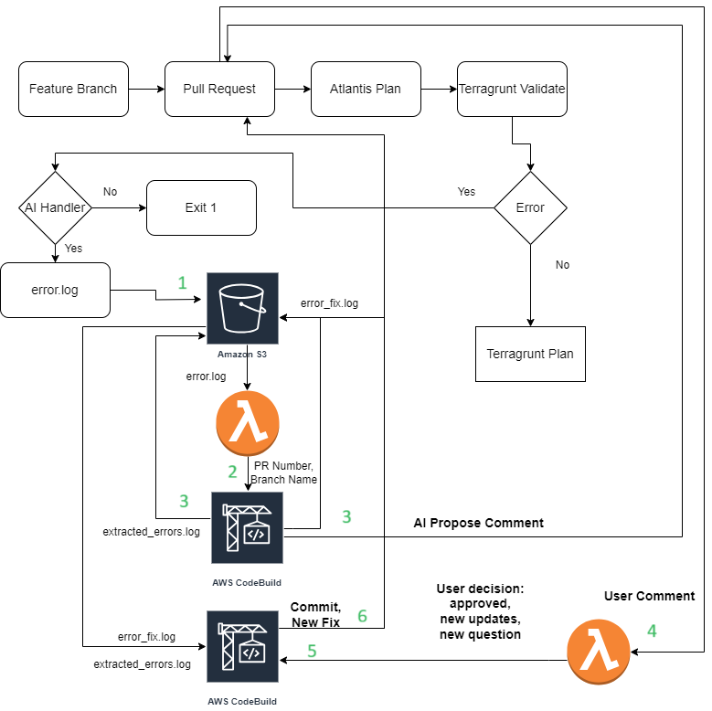
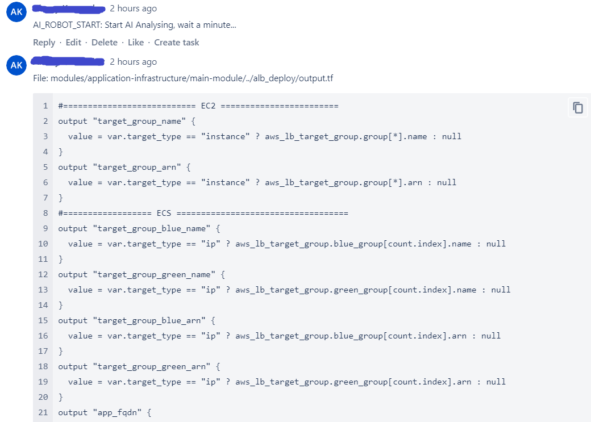
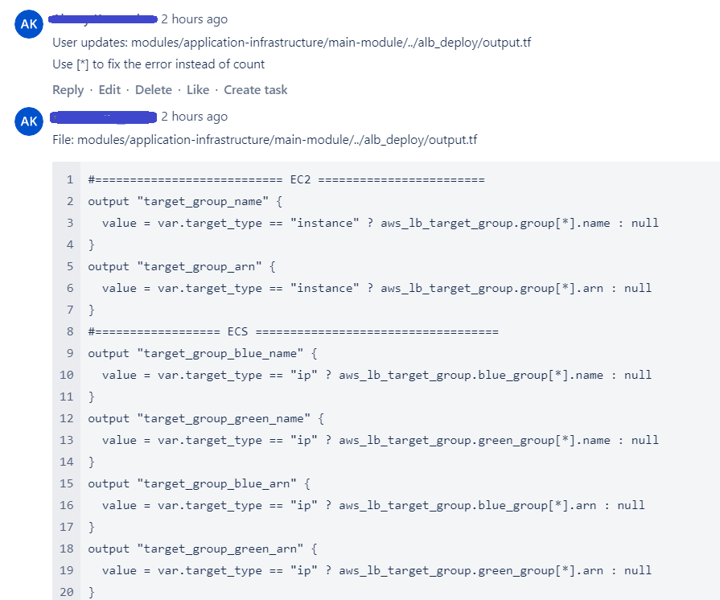
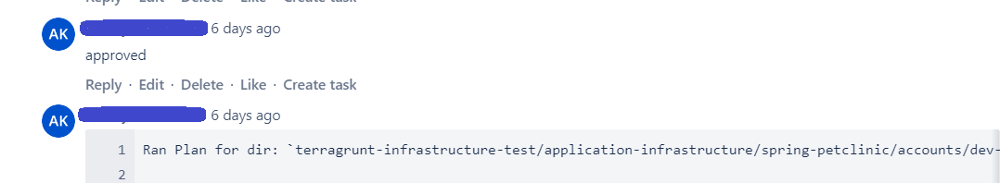
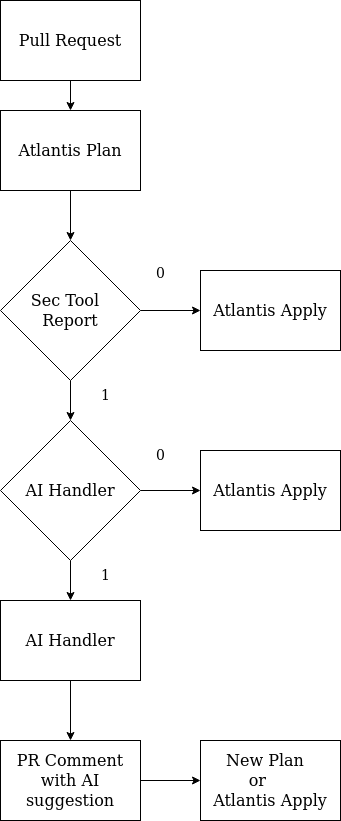
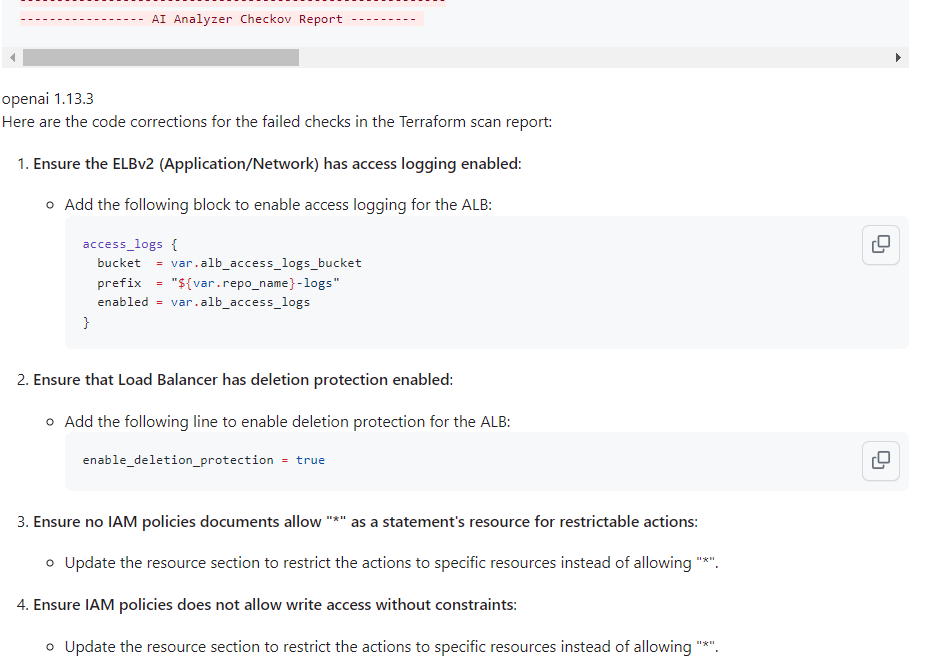

<h1 align="center"> AI Tools for IaC code </h1>
<hr>

> **Disclaimer!** *When using our solution to review your IaC and application code with any external or internal AI platform, we strongly recommend paying particular attention to your responsibility for securing confidential data.*
> *We do not store confidential data and cannot guarantee that the information you provide when using such platforms will remain confidential. Furthermore, we are not responsible for interactions between our solution and any platform, and all potential risks are solely the user's.*
> *Always ensure that all the code and data you share do not contain any confidential or sensitive information. Disclosed data should be de-identified or otherwise prepared in compliance with all data protection requirements. Be informed and clearly understand that you only share data that can be safely disclosed.*
> *By confirming the use of our solution, you agree to take full responsibility for any potential risks associated with revealing your data.*

# Terraform Issue Handler

**Goal:** Since Terraform is a part of Atlantis service we were able to integrate an automatic error handler of Terraform issues with AI.

## Diagram



## Workflow

1. We receive terraform errors in the form of an `error.log` file from Atlantis and store it in an S3 bucket.
2. This change to the `error.log` file triggers the first Lambda function, which then identifies the PR number and branch name, subsequently initiating the first Codebuild.
3. In the first Codebuild, the `error.log` file is processed and an `extracted_errors.log` file is created. Following this, AI suggests a resolution to the error, which leads to the creation of the `error_fix.log` file. This file is then transferred to the S3 bucket. The suggestion made by the AI system is also sent as a comment to the PR.
4. We can copy this suggestion from comment and past to our IDE or continue interacting with AI.
   * **We have three options to post in comment**:
      * **approved** - AI Handler commits changes and pushes to Git, Atlantis starts with new cycle
      * **User updates: \<File Path\> \n \<User proposition to AI\>** - AI Handler reads File Path and tries to create new fixing according a user's comment.
      * **User question: \<Any question to AI\>** - You can ask AI any question, just for fun.
5. The second Lambda function responds based on the user's comment and initiates the second Codebuild to process user feedback.
6. If a User comment is `approved`, changes are committed and a new Atlantis cycle begins. If a User comment is `User updates: file_path`, the second Codebuild attempts to implement a new fix, taking user feedback into account.

## Atlantis integration

``` yaml
#========================== Terragrunt Workflow ==========================#
workflows:
  terragrunt:
    plan:
      steps:
#-------------------------------------------
        - env:
            name: OPENAI_TOKEN
            command: 'aws ssm get-parameter --name "/accelerator/openai_token" --with-decryption | jq .Parameter.Value -r'
        - env:
            name: GIT_TOKEN
            command: 'aws ssm get-parameter --name "/atlantis/github/user/token" --with-decryption | jq .Parameter.Value -r'
        - env: # If we enable AI Handler
            name: AI_HANDLER
            value: 1

#--------------------------------------------

        - run: if [ -s "error.log" ];
            then
            cat error.log;
            if [ $AI_HANDLER == 1 ];
            then
            aws s3 cp error.log s3://${STORAGE_BUCKET}/${BASE_REPO_NAME}/;
            exit 1;
            fi
            fi
        - run: terragrunt plan -out $PLANFILE $DESTROY_PARAMETER -no-color 2> error_raw.log || cat error_raw.log | grep -iv -e 'tflint' -e "validate_tflint" > error.log
        - run: if [ -s "error.log" ];
            then
            cat error.log;
            if [ $AI_HANDLER == 1 ];
            then
            aws s3 cp error.log s3://${STORAGE_BUCKET}/${BASE_REPO_NAME}/;
            fi;
            exit 1;
            fi
#----------------------------------------------
    apply:
      steps:
#----------------------------------------------
        - run: terragrunt apply $PLANFILE -no-color 2> error.log
        - run: if [ -s "error.log" ];
            then
            cat error.log;
            if [ $AI_HANDLER == 1 ];
            then
            aws s3 cp error.log s3://${STORAGE_BUCKET}/${BASE_REPO_NAME}/;
            fi;
            exit 1;
            fi
#------------------------------------------------
```

## Necessary environment variables

* Define AI Handler block in `env.hcl` file for core:
   ``` hcl
  #========================== AI Handler for Terraform ==========================#
  ai_handler_create        = true
  server_type              = local.vcs == "github" ? "GITHUB" : (local.vcs == "bitbucket" ? "BITBUCKET" : "")
  llm_model                = "gpt-3.5-turbo-instruct"
  openai_api_endpoint      = "https://api.openai.com/v1/completions"
  openai_token_name        = "/accelerator/openai_token"
  git_token_name           = "/atlantis/git/user/token"
  ```

* Set AI_HANDLER value to 1 in `atlantis.yml` file:
   ``` yml
   - env:
       name: AI_HANDLER
       value: 1
   ```

## View from Git PR Comment

1. AI Handler first attempt to fix terraform error:

    

2. User updates:

    

3. User approval:

    


## Further reading
* [CI/CD](../cicd.md)
* [Application environments](../docs/app-envs.md)

<hr>

<h1 align="center">Security Tools Report AI Handler</h1>

Currently, we use 3 main security tools to analyze terraform code on security vulnerabilities.

- Checkov
- Regula
- TFSec

The solution explained below handles the report log file left after Security Tool execution. Handle the report and left the advice in a Pull Request comment.

To process Sec Tool Report by OpenAI we use [sec_analyzer.py](../../scripts_ai/sec_analyzer.py) script.

## The Workflow for Sec Tools report processing by AI



## Atlantis integration
AI handler for Regula report is a part of Atlantis. All details of how we run it can be found in atlantis.yaml

We force Atlantis to store Regula output in the error log file

``` yaml
        - run: |
            if [ $CHECKOV == 1 ]; then
              echo "----------------- Checkov Report --------------- "
              cp /tmp/checkov_report.log /tmp/report.log
              cat /tmp/report.log
              echo "----------------------------------------------------------"
              if [ $AI_HANDLER == 1 ]; then
                echo "----------------- AI Analyzer Checkov Report --------- "
                echo "\`\`\`"  # Open Markdown Code Block
                source /home/atlantis/.venv/bin/activate
                pip list | grep openai
                python3 /home/atlantis/.atlantis/repos/${BASE_REPO_OWNER}/${BASE_REPO_NAME}/${PULL_NUM}/${WORKSPACE}/scripts_ai/sec_analyzer.py
                deactivate
                echo "\`\`\`"  # Close Markdown Code Block
              fi
            fi
        - run: |
            if [ $TFSEC == 1 ]; then
              echo "------------------- TFSec Report ------------------- "
              cp /tmp/tfsec_report.log /tmp/report.log
              cat /tmp/report.log
              echo "----------------------------------------------------------"
              if [ $AI_HANDLER == 1 ]; then
                echo "----------------- AI Analyzer TFSec Report --------- "
                echo "\`\`\`";
                source /home/atlantis/.venv/bin/activate;
                pip list | grep openai
                python3 /home/atlantis/.atlantis/repos/${BASE_REPO_OWNER}/${BASE_REPO_NAME}/${PULL_NUM}/${WORKSPACE}/scripts_ai/sec_analyzer.py
                deactivate
                echo "\`\`\`"
              fi
            fi
        - run: |
            if [ $REGULA == 1 ]; then
              regula run -t tf-plan $SHOWFILE > /tmp/report.log
              echo "\`\`\`"
              cat /tmp/report.log
              if [ $AI_HANDLER == 1 ]; then
                echo "-------- Regula Report. Checking with OpenAI ---------"
                source /home/atlantis/.venv/bin/activate
                python3 /home/atlantis/.atlantis/repos/${BASE_REPO_OWNER}/${BASE_REPO_NAME}/${PULL_NUM}/${WORKSPACE}/scripts_ai/sec_analyzer.py
                deactivate
                echo "\`\`\`"
              fi
            fi
```

1) We get report files from `Checkov` and `TFSec` from Terragrunt Hook, see [here](../linters.md#terragrunt-hooks)
2) Regula utility uses TF Plan during Atlantis plan workflow

3) If Security Tools generate `report.log` file, and we set to `1` this utility, we can see their report
4) If we set `AI_Handler` to `1`, this report will be process by AI script, and we see AI suggestion in PR Comment

## Results
Appear in the PR comment


#### [Main page](../infra.md)
