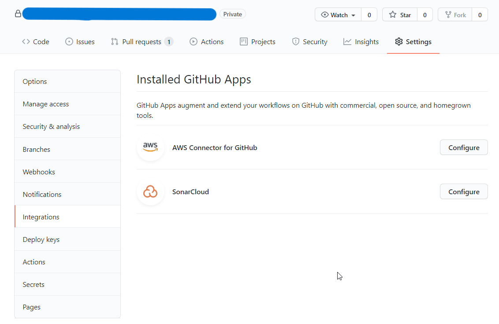
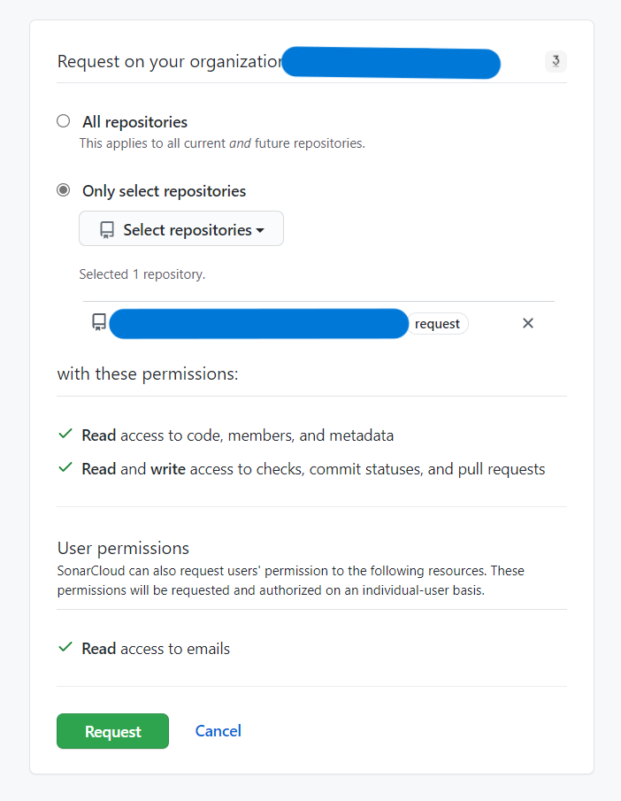
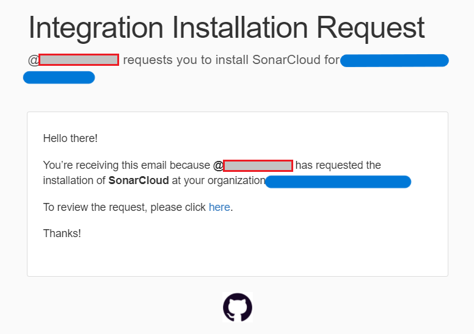
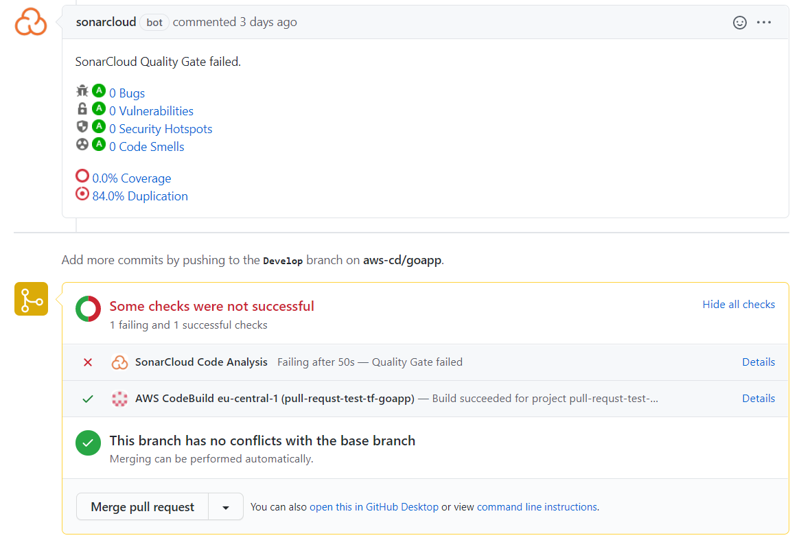
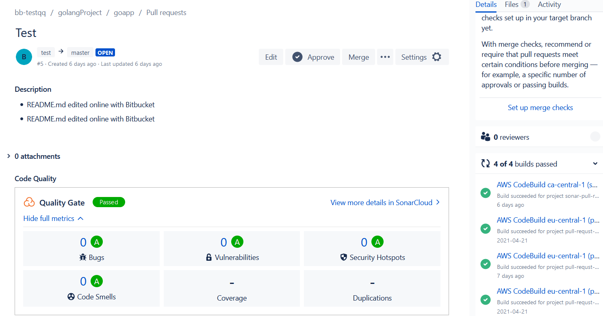
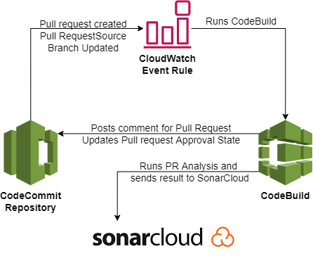
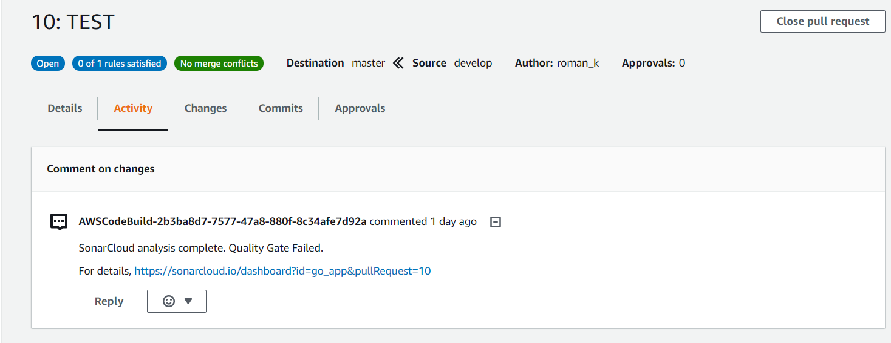
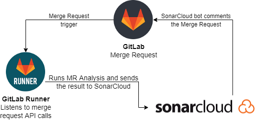
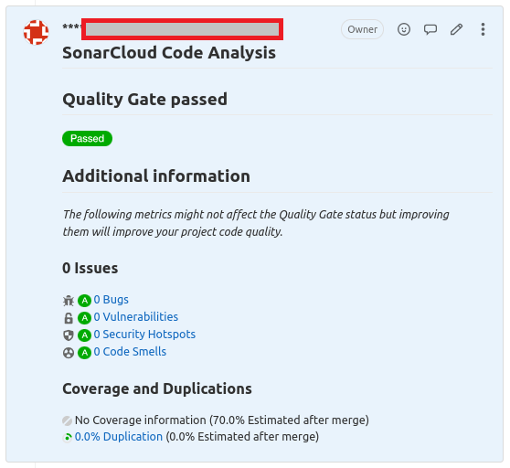

<h1 align="center">SonarCloud Pull Request Analisis</h1>

* [GitHub or Bitbucket Pull Requests](./PRanalysis.md#github-or-bitbucket-pull-requests)
* [CodeCommit Pull Requests](./PRanalysis.md#codecommit-pull-requests)
* [GitLab Merge requests](./PRanalysis.md#gitlab-merge-requests)


For now, we support PR analysis with GitHub, Bitbucket and CodeCommit.


## GitHub or Bitbucket Pull Requests

Set variable `sonarcloud_token` in [app_parameter_store.hcl](../terragrunt-infrastructure-example/accelerator/accounts/aws_account_id/regions/example/setup_folder/applications/example/app_parameter_store_example.hcl) file to connect with Sonar:


See this [quick start guide](../docs/SonarCloud_configuration.md) if you don't have a SonarCloud organization.
If you're adding a new app to Accelerator, check if it has the SonarCloud app in your Installed GitHub apps.



Otherwise, you need to add SonarCloud permission to install this app. To do this, you can send a request to your organization.



And ask your admin to approve it.



After this step, you need to copy the `buildspec_pr.yml` file with the necessary configuration to the root folder of the application: [buildspec_pr.yml](../docs/template_config_files/buildspec_pr.yml)

The analysis procedure will be launched as soon as a Pull request occurs in the observable repository.

After the analysis you will get a similar output in your pull request window.
GitHub:



Bitbucket:



### Sonar AI Handler
* **If you want that Sonar issues will be processed by Open AI Handler, `openai_token` variable should be set in [parameter_store.hcl](../terragrunt-infrastructure-example/parameter_store_example.hcl)**
* More about AI Handler see [**here**](../docs/AI/ai_for_app.md).

<hr>

## CodeCommit Pull Requests




CloudWatch Event Rule will be created and monitor the CodeCommit repository for `pullRequestCreated` and `pullRequestSourceBranchUpdated`. Once it notices one of the events, it will trigger the CodeBuild in project, which will run SonarCloud analysis according to `buildspec_pr.yml`. [Here](template_config_files/buildspec_pr.yml) is an example of a pull request analysis buildspec file.

**Additional**:
You can create an `Approval rule template`, which will deny all attempts of merging `Pull Requests` until **approval** is received. To create it, you need to:
1. Log in to AWS Console
2. Select CodeCommit and choose `Approval rule templates`
3. Click on `Create template`
4. Give the rule a name (e.g., SonarCloud Pull Request Analysis)
5. Add `Approval pool members` and enter either the CodeBuild execution role (e.g. arn:aws:sts::**AccoutID**:assumed-role/**CodeBuildIAMRoleName**/*) , or the IAM role name of your CodeBuild role (e.g. my_codebuild_approval_role_name)
6. Under `Associated repositories`, find and select the repositories you want to have this approval

After the analysis, you will get a similar output in your pull request window (Activity):



## GitLab Merge requests



* GitLab VCS does not natively interact with AWS CodePipeline, so we will perform the Sonar test analysis using GitLab CI in the application repository. To do this, fill in the parameters for AWS-GITLAB Integration section in the [app_parameter_store.hcl](../terragrunt-infrastructure-example/accelerator/accounts/aws_account_id/regions/example/setup_folder/applications/example/app_parameter_store_example.hcl) file accordingly:

**GitLab**
```
# ===================== AWS-GITLAB Integration ====================#
  #   Define these variables if your application is hosted on GitLab #
  # ======================== GitLab Block ===========================#
  gitlab_hostname = ""
  project_id      = ""
  aws_user_name   = ""
  gitlab_token    = ""
  gitlab_user     = ""
  app_language    = "go" # "python", "java"

  #============================= PR Sonar ============================#
  sonarcloud_token = "" # Token for SonarCloud.
```

After the analysis you will get a similar output in your pull request window.



#### [Previous page](./cicd.md)
