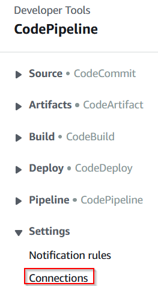
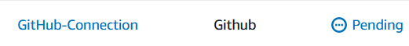
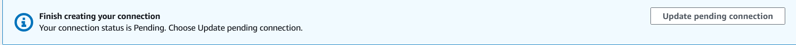

<h1 align="center"> Application Code Hosting platforms </h1>

The Application can be hosted on these Code Hosting platforms:
* [AWS CodeCommit](./app-vcs.md#codecommit-and-gitlab)
* [Bitbucket](./app-vcs.md#github-and-bitbucket)
* [GitHub](./app-vcs.md#github-and-bitbucket)
* [GitLab](./app-vcs.md#codecommit-and-gitlab)

To connect one of the VCSs as a platform for code, you need to fill in the **Application Pipeline block** in the configuration file of your infrastructure `terragrunt-infrastructure-<"your_region_1">/accelerator/accounts/aws_account_id/regions/<"your_region_1">/applications/<"application-1">/env.hcl`. You also need to add the VCS access token to the git_token variable of your [app_parameter_store](../terragrunt-infrastructure-example/accelerator/accounts/aws_account_id/regions/example/setup_folder/applications/example/app_parameter_store_example.hcl) file and apply changes via Terragrunt.

## GitHub and Bitbucket

Once the changes have been applied, you have to log into AWS Management Console and select the service "CodePipeline":

Go into the "Settings" tab, and you will see a pending connection:

Update this connection, and a new window will pop up where you will need to create a link for your connection with the selected Code Hosting platform. **Connection is possible only with approval from the owner of your VCS organization!**

## CodeCommit and GitLab
