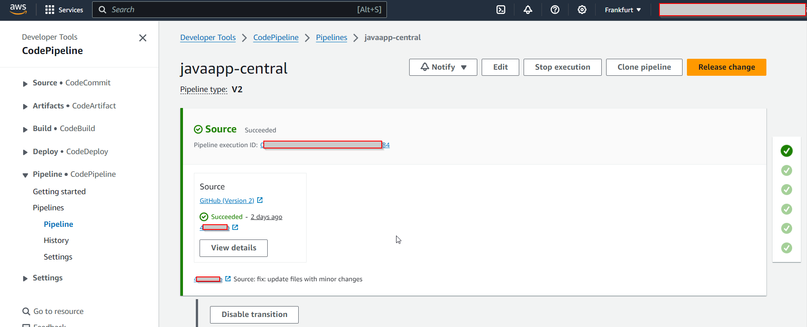
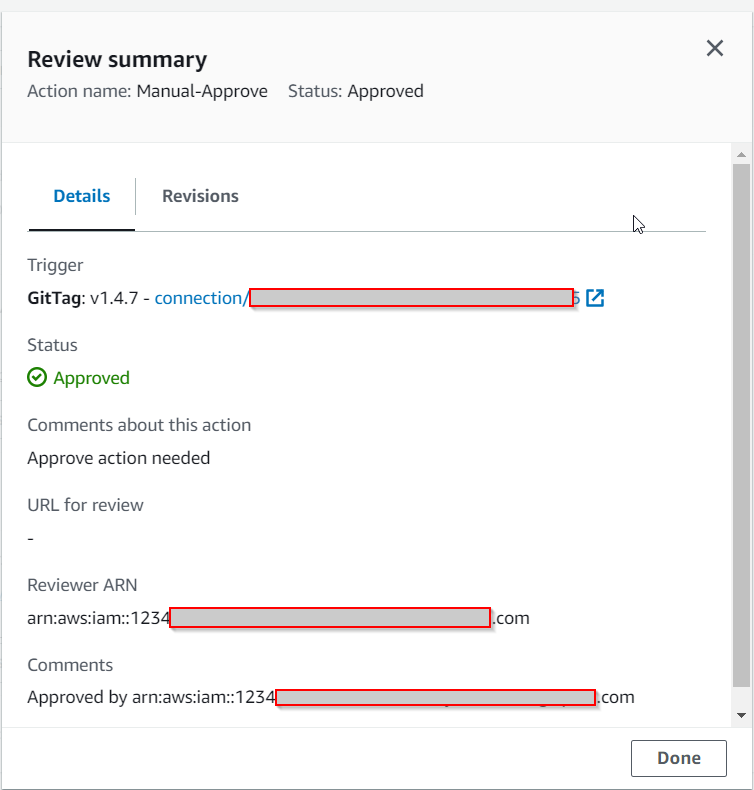
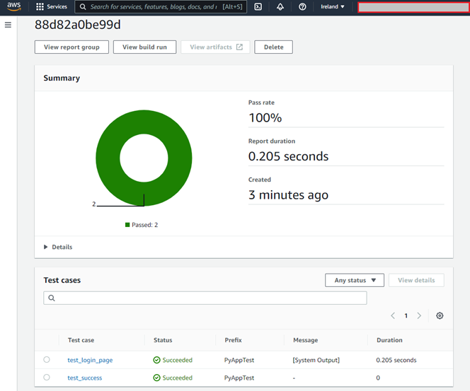
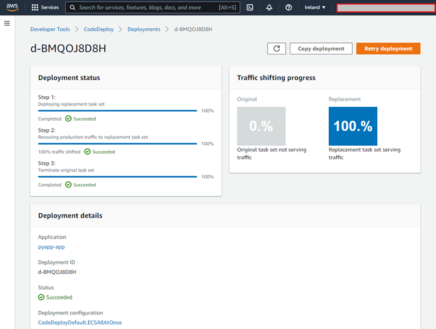
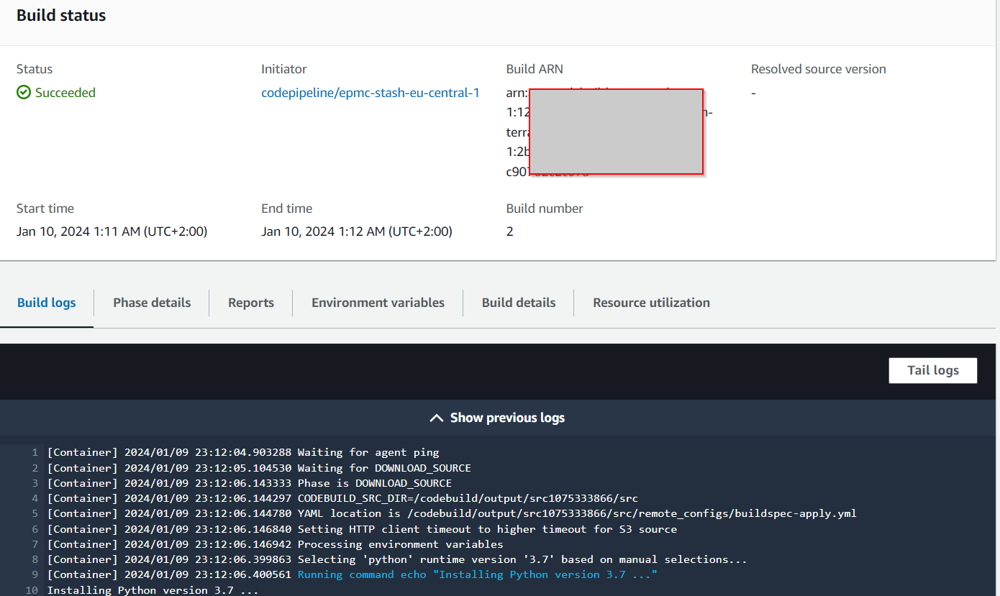

<h1 align="center"> Quick User Guide </h1>

Before moving forward to the interfaces, few words about the development concept our project adheres to. This CI/CD pipeline is designed in line with the **Trunk-based Development** principle. You can delve further into what it entails by clicking on this [link](https://trunkbaseddevelopment.com/).

The pipeline has been set up to trigger from the Main (Trunk) branch of the application's repository. For a developer to launch it, they need to open a **PR** or **MR** request depending on the **VCS** they're working with, going from the development branch to the Trunk branch. More details can be found using this [link](PRanalysis.md). Both branches should be correctly defined in atlantis.yaml. More details can be found at this [link](./infra.md). Once the person in charge has reviewed the code, it will be merged into the final branch, kick-starting the pipeline automatically.

In-depth information about the up-to-the-minute state of the CI/CD process is available on AWS CodePipeline. More details can be found at this [link](https://aws.amazon.com/en/codepipeline/).

In addition to that, quality control of the final publication is manually carried out using the AWS CodePipeline console in the pipeline's last stage.

If needed, one can set up one or multiple notification methods about the operation of the pipeline. More details can be found at this [link](./notifications.md).

Access to the pipeline may be restricted for Development and QA teams as per the project's DevOps agreement.
Teams may access the web consoles of the relevant tools depending on their functional roles and the tools they use, such as [DLT](./dlt.md), [Sonar](./SonarCloud_configuration.md), [Amazon CloudWatch Synthetics](./AWS_Synthetics.md), [Carrier](./Carrier.md) [Report Portal](./Report_Portal.md) or CodeBuild outputs for those tools that don’t have their own web interface.

Furthermore, there are options for manual version deployments (EC2 and ECS deployment) managed via the CodeDeploy service meant for the DevOps team or the person responsible for infrastructure.

Also, the launch history and logs displaying pipeline results at various stages are available for viewing in the respective sections of the CodeBuild service.

Bear in mind, the composition of a particular pipeline implementation depends on the number and type of tools used and can be further customized!

#### [Previous page](../README.md)
